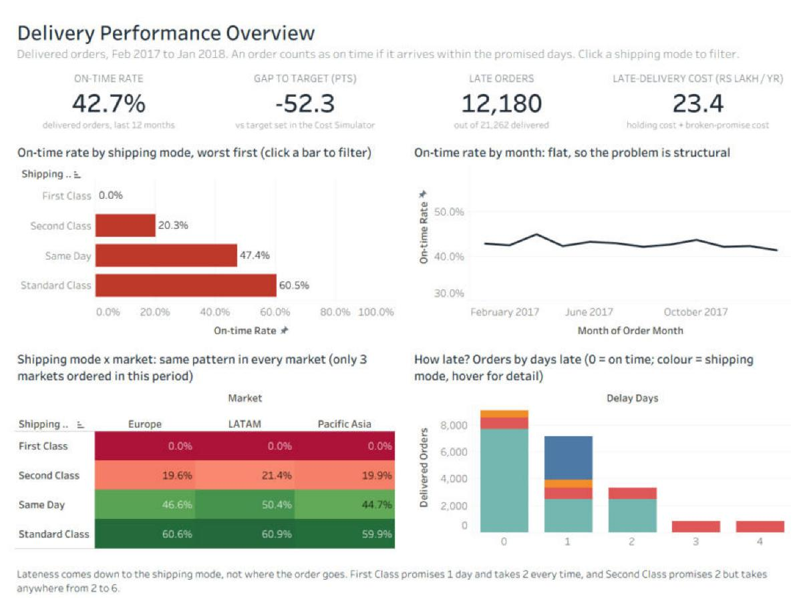
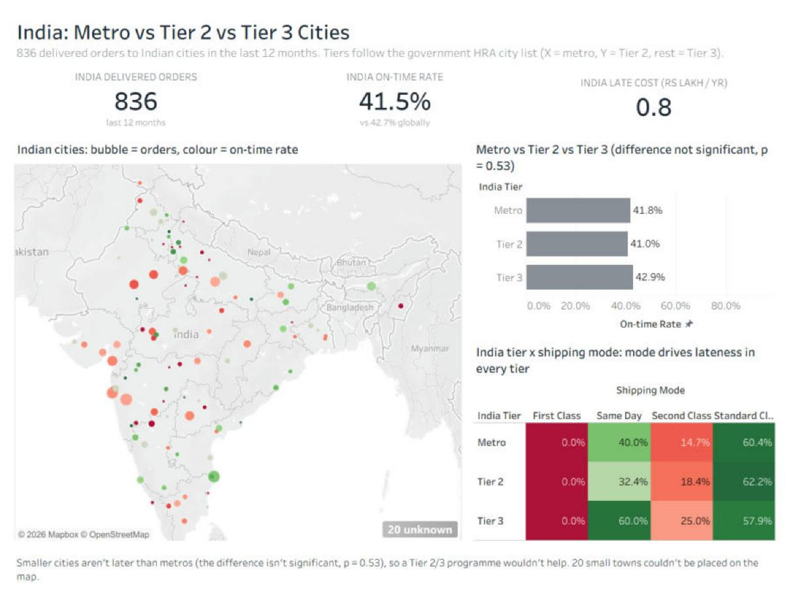
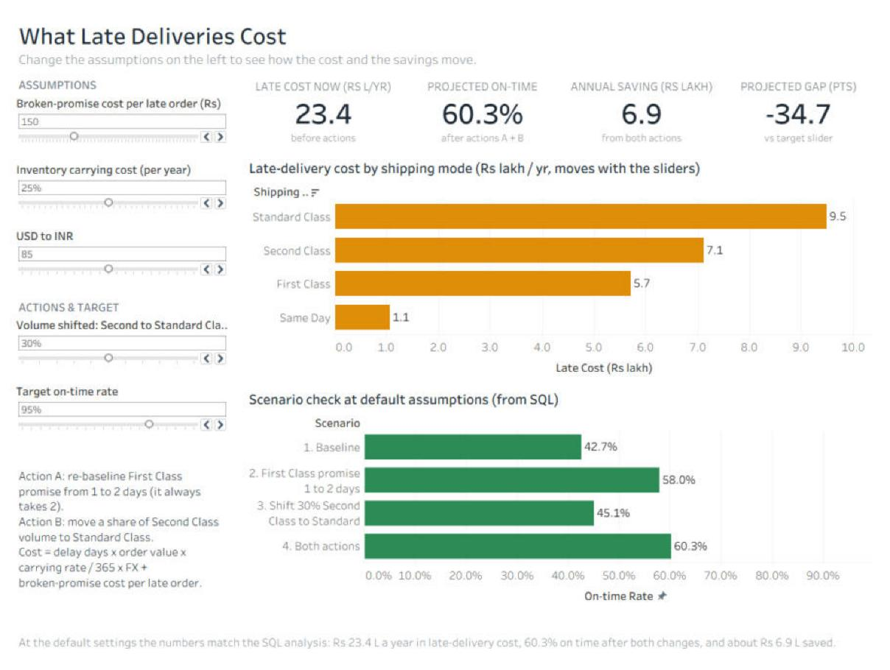

# Delivery Performance & SLA Analysis

I wanted to answer a simple ops question: which shipping modes, regions and product categories miss their delivery promise most often, and what does that cost? I framed it around Indian e-commerce (think Flipkart, Meesho, Nykaa), where the promised delivery date at checkout matters a lot and a missed date usually means a support ticket, a cancellation or an RTO.

Short version: only 42.7% of orders arrived on time in the last 12 months of data, against a 95% target. Lateness costs roughly Rs 23.4 lakh a year. It isn't a geography problem. It's the delivery promise per shipping mode. First Class promises 1 day and takes 2 every single time.

Tools: PostgreSQL, SQL, Tableau Public, a bit of Python for the significance tests.

## Data

[DataCo Smart Supply Chain](https://www.kaggle.com/datasets/shashwatwork/dataco-smart-supply-chain-for-big-data-analysis) from Kaggle: 180,519 order lines, 65,752 orders, Jan 2015 to Jan 2018. It has about 2,150 orders shipped to 146 Indian cities, which is what made the metro vs Tier 2/3 comparison possible.

I started with the smaller "Supply Chain Analysis" dataset that gets recommended for this kind of project. It has 100 rows and no dates, so there is no way to compare scheduled vs actual delivery or show a trend. DataCo has both.

The raw CSV is 96 MB, so it isn't in the repo. Download `DataCoSupplyChainDataset.csv` from the link above.

Things I had to deal with while cleaning:

- The file is Latin-1, not UTF-8 (Rajastán, São Paulo etc. break otherwise).
- Dates are US format (M/D/YYYY). Excel turned 2/3/2018 into 2 March when I first opened it, so all date parsing happens in SQL.
- Trailing and double spaces in region, category and product names (17,925 rows in region alone).
- Emails and passwords are masked, a few columns are empty, and 6 columns are exact copies of other columns. I checked each pair before dropping it.
- The data is one row per item, not per order. All items in an order share the same shipping mode and dates, so I count on-time per order. Otherwise big orders get counted several times.
- 7,754 order lines are cancelled (SUSPECTED_FRAUD or CANCELED). I left those out of the on-time numbers.
- There's no carrier column, so I used shipping mode (Standard / Second / First Class / Same Day) as the service level instead.
- Actual shipping days are spread almost perfectly evenly within each mode (Second Class is basically uniform between 2 and 6 days), so the data looks simulated. I treat the results as a demo of the method rather than a real-world finding.

## How it's built

On-time means actual shipping days are less than or equal to the promised days. `delay_days` is how many days over the promise an order was (0 if on time).

| File | What it does |
|---|---|
| [sql/01_load.sql](sql/01_load.sql) | Raw table (everything as text) and the `COPY` load |
| [sql/02_clean.sql](sql/02_clean.sql) | Typed, trimmed `deliveries` table with `delay_days`, `is_late`, `is_cancelled` |
| [sql/03_city_tiers.sql](sql/03_city_tiers.sql) | India Metro / Tier 2 / Tier 3 lookup |
| [sql/04_orders_view.sql](sql/04_orders_view.sql) | One row per order |
| [sql/05_ontime_by_dimension.sql](sql/05_ontime_by_dimension.sql) | On-time % by mode, market, region, tier and category, ranked worst first, with the gap to 95% |
| [sql/06_cost_impact.sql](sql/06_cost_impact.sql) | Cost of late deliveries and the what-if scenarios |
| [sql/07_monthly_trend.sql](sql/07_monthly_trend.sql) | Monthly trend with a 3-month rolling average |
| [sql/08_export_for_tableau.sql](sql/08_export_for_tableau.sql) | CSV exports for Tableau |
| [python/stat_tests.py](python/stat_tests.py) | Chi-square and z-tests behind the "X is worse than Y" claims |

India tiers follow the government's HRA city classification: X cities are Metro, Y cities are Tier 2, everything else is Tier 3. Kolkata and Ahmedabad aren't in the India orders, so there are 7 metros.

For cost I used two parts:

1. Holding cost, the way the brief suggested: delay days x order value x 25% a year / 365.
2. A flat Rs 150 per late order for the support contact, goodwill voucher and some share of cancellations/RTO.

Sales are in USD, so I converted at Rs 85. All of these numbers are assumptions and they sit in one table (`cost_params`), so they're easy to change. Holding cost on its own is small (Rs 5.1 L). Most of the cost comes from the broken-promise part.

## What I found

Latest 12 months (Feb 2017 to Jan 2018), 21,262 delivered orders:

| Shipping mode | Orders | On-time | Gap to 95% | Late cost (Rs L / yr) |
|---|---:|---:|---:|---:|
| First Class | 3,245 | 0.0% | -95.0 pts | 5.71 |
| Second Class | 4,153 | 20.3% | -74.7 pts | 7.11 |
| Same Day | 1,169 | 47.4% | -47.6 pts | 1.07 |
| Standard Class | 12,695 | 60.5% | -34.5 pts | 9.49 |
| All orders | 21,262 | 42.7% | -52.3 pts | 23.38 |

- Shipping mode is what drives lateness (chi-square p < 0.001, Cramér's V 0.48). First Class is promised in 1 day and always takes 2. Second Class is promised in 2 and takes anywhere from 2 to 6.
- Geography doesn't explain it. Market (p = 0.53), region (p = 0.10) and India tier (p = 0.53) show no real difference. Indian metros were actually 1.4 points worse than Tier 2/3 cities, which isn't significant either. Every tier shows the same pattern by mode.
- Standard Class has the best on-time rate but the biggest share of the cost (41%), because it carries most of the volume.
- The monthly trend is flat (41.3% to 45.0%), so this isn't seasonal.

## Recommendation

Full write-up: [reports/recommendation.md](reports/recommendation.md)

| Scenario (12 months) | On-time | Saving |
|---|---:|---:|
| Today | 42.7% | |
| Change the First Class promise from 1 to 2 days | 58.0% | Rs 5.7 L |
| Move 30% of Second Class volume to Standard | 45.1% | Rs 1.2 L |
| Both | 60.3% | Rs 6.9 L |

I'd also renegotiate the Second Class transit SLA (3 days max, with a penalty per late order). I wouldn't spend money on a Tier 2/3-specific programme, since the tier difference isn't real.

## Dashboard

Live on Tableau Public: [Delivery Performance](https://public.tableau.com/app/profile/deepti.singh.kushwaha/viz/DeliveryPerformance_17945713159400/ExecutiveOverview). The workbook is also in the repo at [tableau/Delivery Performance.twbx](tableau/Delivery%20Performance.twbx). It has three dashboards:

- **Executive Overview**: KPIs, on-time by mode (click a bar to filter the rest), monthly trend, mode x market heatmap and a "how late" distribution
- **India Lens**: a city map, Metro vs Tier 2 vs Tier 3, and a tier x mode heatmap
- **Cost Simulator**: sliders for the cost assumptions, the volume shift and the target. The cost, projected on-time rate and saving update as you move them.

## Running it

1. Create a PostgreSQL database called `delivery_sla`.
2. Copy the DataCo CSV to `C:\Users\Public\dataco.csv`. The PostgreSQL service on Windows can't read from my Downloads folder, but it can read from Public.
3. Run `run_all.bat`. It runs `sql/01` to `08` in order and writes the CSVs to `exports/`.
4. Optional: `py python/stat_tests.py` (needs pandas, scipy and statsmodels).

## Limitations

- The data looks simulated, so I'd want to check this against real carrier scan data before acting on it.
- Shipping mode stands in for carrier.
- The cost inputs are my assumptions. A real ops team would plug in their actual carrying cost and contact-centre numbers.
